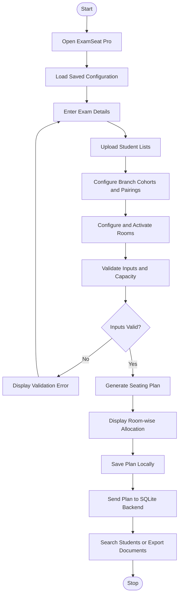
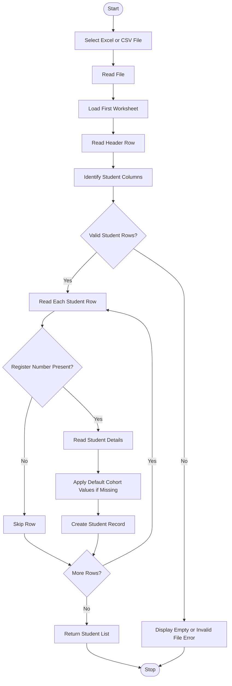
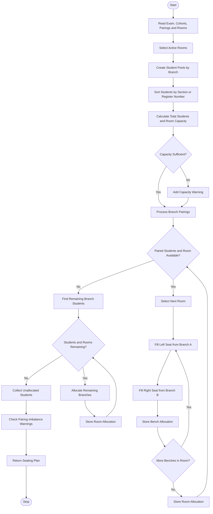
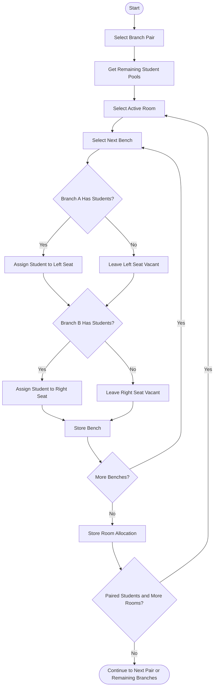
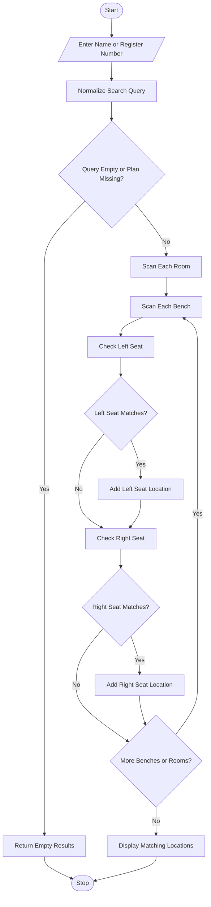
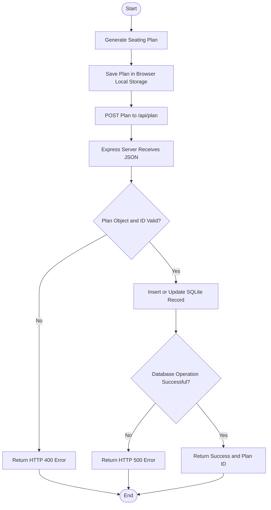

# ExamSeat Pro – Flowcharts

These diagrams represent the workflows of the ExamSeat Pro application. GitHub renders Mermaid diagrams when this Markdown file is viewed in the repository.

## 1. Overall System Workflow

## 2. Student File Upload Flowchart

## 3. Seating Generation Flowchart

## 4. Branch Pairing and Bench Allocation Flowchart

## 5. Student Search Flowchart

## 6. Seating Plan Save and Retrieval Flowchart

## 7. Flowchart Symbol Reference

| Symbol | Meaning |
|---|---|
| Oval | Start or Stop |
| Rectangle | Processing step |
| Parallelogram | Input or Output |
| Diamond | Decision |
| Arrow | Direction of control flow |
